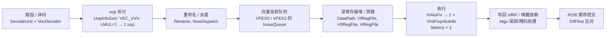

# 阶段一：环境部署与向量加法指令（`vadd.vv`）执行过程分析文档

> **赛题名称**：面向边缘 AI 大语言模型推理的 RISC-V 自定义 `vdot` 指令设计——基于“香山”昆明湖 V2 处理器架构
> **赛事赛道**：2026 CIE 全国 RISC-V 高水平创新及应用大赛（CIE-香山社区·RISC-V 应用创新赛道）
> **覆盖评分项**：阶段一（15%）：`1.1` 环境与源码部署验证、`1.2` 操作日志、`1.3` 向量加法指令执行过程分析
> **文档版本**：v3（2026-11-04）。相对上一版：修正了 `vadd.vv` 所用功能单元与延迟的描述；单元级波形表改为与 `vadd_e8.vcd` 实际内容一致；新增在**香山全芯片 `emu` 中**跟踪 `vadd.vv` 的波形分析。

---

## 1. 环境与源码部署验证（对应评分项 1.1 & 1.2）

### 1.1 开发与仿真环境

Windows 11 + WSL2（Ubuntu 24.04），全部工具链运行在 WSL2 中。

| 组件 | 版本 / 位置 | 用途 |
| :--- | :--- | :--- |
| XiangShan | `f86f50b`（kunminghu-v2 主线），`/root/codex-work/xiangshan-vdot-2026/XiangShan`（WSL ext4） | 处理器 RTL（含 YunSuan、difftest 等子模块） |
| NEMU | `a48a11f`，`/root/codex-work/vdot-build/NEMU` | 指令集参考模型（独立解释器 + DiffTest REF 动态库） |
| JDK / Mill | OpenJDK 17.0.18、Mill 0.11.7 | Chisel 编译、Verilog 生成、ChiselTest |
| Verilator | 5.020 | 全芯片 `emu` 与模块级仿真 |
| Yosys | 0.33 | 门级综合（阶段二 DSE） |
| 交叉编译器 | `riscv64-linux-gnu-gcc` 13.3.0 | 裸机测试程序 |

### 1.2 环境验证输出

按 XiangShanLab 题库“初级 1”的反馈标准，输出格式为 `hello xiangshan, I am xxx (姓名), from (学校), in (IP address)`。程序 `vdot-contest/software/bench/hello_xiangshan.c` 在编译时由 Makefile 注入姓名、学校和本机 IP（取默认路由的源地址，即本机有线网卡的局域网地址 `192.168.31.250`），分别在**香山 RTL 仿真器 emu（带 DiffTest）**与 NEMU 上运行（完整输出见 `logs/hello_xiangshan.log`）：

```text
$ cd /root/codex-work/xiangshan-vdot-2026/XiangShan
$ ./build/emu -i vdot-contest/build/hello_xiangshan.bin --diff riscv64-nemu-interpreter-vdot-so
...
The first instruction of core 0 has commited. Difftest enabled.
hello xiangshan, I am 曾俊翔, from 电子科技大学, in 192.168.31.250
Core 0: HIT GOOD TRAP at pc = 0x80000042
Core-0 instrCnt = 332, cycleCnt = 4843, IPC = 0.068553

$ riscv64-nemu-interpreter-vdot -b vdot-contest/build/hello_xiangshan.bin
hello xiangshan, I am 曾俊翔, from 电子科技大学, in 192.168.31.250
nemu: HIT GOOD TRAP at pc = 0x0000000080000042
```

（香山官方教程中的 hello 程序基于 nexus-am 的 `apps/hello`；本项目没有拉取 nexus-am 子模块，使用自带的最小裸机运行时 `bench/crt0.S`，程序同样从 `0x80000000` 启动、通过 uartlite 输出，运行方式与教程中的 `./build/emu -i <程序>.bin` 完全一致。）

### 1.3 关键操作日志（完整实测输出见 `logs/`）

1. **源码与子模块**：`git clone https://github.com/OpenXiangShan/XiangShan.git && cd XiangShan && make init`。
2. **NEMU（两个构建目标）**：
   ```bash
   make riscv64-xs_defconfig && make -j12        # 独立解释器 build/riscv64-nemu-interpreter
   make riscv64-xs-ref_defconfig && make -j12    # DiffTest REF：build/riscv64-nemu-interpreter-so
   ```
3. **香山全芯片仿真器 `emu`（带 DiffTest）**：
   ```bash
   export NOOP_HOME=$PWD NEMU_HOME=/path/to/NEMU
   make sim-verilog CONFIG=MinimalConfig NUM_CORES=1 WITH_CHISELDB=0 WITH_CONSTANTIN=0 DISABLE_PERF=1 JVM_XMX=6G
   make -C difftest emu NUM_CORES=1 RTL_SUFFIX=sv EMU_THREADS=0 EMU_TRACE=fst -j6
   ./build/emu -i program.bin --diff /path/to/riscv64-nemu-interpreter-so
   ```
   本机只有 15.7 GB 物理内存（WSL2 上限 12 GB），而 Windows 侧已占用大量内存。实测中直接以 8 GB 堆生成 Verilog 时 WSL2 虚拟机被宿主机整体重启。最终做法：在 WSL 内另加 16 GB swap 文件，并把整个构建放进内存上限 5.5 GB 的 cgroup（`vdot-build/run_capped.sh`），溢出部分走 Linux swap，构建得以稳定完成。各步骤耗时与峰值内存见 `logs/emu_build.log`。

实测构建过程（`logs/emu_build.log`）：

| 步骤 | 命令 | 耗时 | 峰值内存 |
| :--- | :--- | ---: | ---: |
| Verilog 生成 | `make sim-verilog CONFIG=MinimalConfig …`（mill + firtool，1933 个 `.sv`，约 1 GB） | 28 min 19 s | 5.6 GB |
| Verilator 生成 C++ | `verilator --exe -O3 --cc --top-module SimTop …`（549 个 `.cpp`） | 2 h 33 min | 7.8 GB |
| C++ 编译 | `make -C difftest emu … OBJCACHE=ccache -j6` | 44 min 40 s | 6.8 GB |
| 单个超大文件 | `VSimTop___024root__DepSet_hd5918264__168.cpp`（7.9 MB）改用 `-O1` | 1 min 50 s | 0.9 GB |

香山 Makefile 的默认配置 `CONFIG=DefaultConfig`（ROB 160、64 KB L1D、1 MB L2、16 MB L3）也在本机构建成功：Verilog 生成 24 min（峰值 9.8 GB，RTL 1.6 GB），Verilator 4 h 38 min（11.0 GB），C++ 编译约 58 min（`logs/emu_build.log` 第 7 节、`vdot-contest/tools/build-scripts/build_emu_default.sh`）；在它上面运行的全部测试与性能对比见阶段三 2.7、4.5 节。

构建中实际遇到并解决的三个环境问题：

1. **宿主机内存**：见上文，cgroup 限额 + 额外 swap。
2. **difftest 与 Verilator 5.020 不兼容**：开启波形（`EMU_TRACE=fst`）时 `difftest/src/test/csrc/verilator/waveform.h` 使用了 Verilator 5.020 中尚不存在的 `VerilatedTraceBaseC`，C++ 编译报错。按版本号加了一个类型别名（`vdot-contest/tools/difftest-verilator5020-trace.patch`，只影响仿真框架，不影响 RTL）。
3. **单个生成文件 `-O3` 编译需约 17 GB 虚拟内存**：该文件单独改用 `-O1` 编译（为此需要保留预编译头的 `.fast` 头文件，否则 GCC 因优化选项与 PCH 不一致而找不到头文件），其余文件仍为 `-O3`。

---

## 2. 香山昆明湖 V2 中 `vadd.vv` 的执行过程（对应评分项 1.3）

### 2.1 指令编码与语义

`vadd.vv vd, vs2, vs1, vm`：`opcode = 1010111`（OP-V），`funct3 = 000`（OPIVV），`funct6 = 000000`。`VLEN = 128`、`SEW = 8`、`LMUL = 1` 时对 16 个字节通道逐元素做模 $2^8$ 加法：

$$\forall i \in [0, 15]:\quad vd[8i+7:8i] = (vs2[8i+7:8i] + vs1[8i+7:8i]) \bmod 2^8$$

### 2.2 源码中的执行路径（逐级对应 RTL 文件）



1. **译码**（`backend/decode/VecDecoder.scala`）：`VADD_VV -> OPIVV(FuType.vialuF, VialuFixType.vadd_vv, T, F, F)`，即功能单元类型为 `vialuF`（向量整数定点 ALU），内部操作码 `VialuFixType.vadd_vv`。`VecExceptionGen` 检查 `vill`、寄存器对齐、`vstart` 等合法性。
2. **uop 拆分**（`UopInfoGen.scala`）：`OPIVV` 默认拆分类型 `VEC_VVV`，uop 数 = LMUL，`m1` 时为 1 个 128 位 uop。
3. **重命名 / 派遣**：源操作数 `vs1`、`vs2`、old vd（`src3`，用于 `ta/ma` 的尾部/掩码保持）、`v0`（仅 `vm = 0` 时）、`vl/vtype`。当 `vl = VLMAX` 且尾部/掩码均为 agnostic 时，`NewDispatch` 的 `ignoreOldVd` 会去掉对 old vd 的依赖。
4. **发射与执行**：`vialuF` 在 `VFEX0` 和 `VFEX2` 两个向量执行单元中各有一份（`Parameters.scala`）。`VIAluFix`（`backend/fu/wrapper/VIAluFix.scala`）把 128 位数据拆成两个 64 位的 YunSuan `VIntFixpAlu64b`，`VialuCfg` 的固定延迟为 **1 拍**（`CertainLatency(1)`）。
5. **字节进位隔离**：64 位加法器在 `SEW = 8` 时在每个字节边界截断进位，128 位数据通路等价于 16 个独立的 8 位加法器。
6. **写回与提交**：结果经 `Mgu` 按 `vl/vta/vma/vm` 合并后写回向量物理寄存器堆，唤醒依赖指令；ROB 顺序提交时 DiffTest 将架构状态与 NEMU 比对。

### 2.3 全芯片波形：`vadd.vv` 在香山流水线中的时间线

测试程序 `vdot-contest/software/vadd_trace.S`：`vs1 = [1..16]`，`vs2 = [10, 20, …, 120, -10, -20, -30, -40]`，执行 `vadd.vv v3, v2, v1` 后用 `vse8.v` 取回并与期望值比较（期望 `0xe8f1fa03_84796e63_584d4237_2c21160b`）。在 `emu` 中以 `--dump-wave` 导出 FST 波形，再用本项目的 `vdot-contest/tools/fstdump` 提取关键信号：

```bash
emu -i vadd_trace.bin --diff riscv64-nemu-interpreter-vdot-so --dump-wave --wave-path vadd_trace.fst
python3 vdot-contest/tools/trace_timeline.py vadd_trace.fst --instr 0x022081d7 --fu VialuFix
```

运行结果：`HIT GOOD TRAP`，`instrCnt = 28, cycleCnt = 1510`（DiffTest 逐条比对通过）。`vadd.vv v3, v2, v1` 的机器码为 `0x022081d7`，在波形中的时间线（emu 每个时钟上升沿后记录一次，FST 时间 = 周期号）：

| 阶段 | 周期 | 波形中的信号（层次前缀 `TOP.SimTop.cpu.l_soc.core_with_l2.core.backend.`） |
| :--- | ---: | :--- |
| 译码输出 | 1421 | `inner_ctrlBlock.decode.io_out_0_valid = 1`，`io_out_0_bits_instr = 0x022081d7`（向量指令经复杂译码器逐条从 0 号口输出） |
| 重命名输出 | 1422 | `inner_ctrlBlock.rename.io_out_0_valid = 1`，分配 ROB 表项 |
| 进入功能单元 | 1462 | `inner_vfExuBlock.exus_2.VialuFix.io_in_valid = 1`（VFEX2 中的 vialu；等待两条 `vle8.v` 的数据从存储器返回约 40 拍） |
| 功能单元输出 | 1463 | `VialuFix.io_out_valid = 1`，`io_out_bits_res_data = 0xe8f1fa0384796e63584d42372c21160b`（vialu 延迟 1 拍） |
| 提交 | 1469 | `TOP.SimTop.endpoint.commit.io_bits_valid = 1`，`io_bits_instr = 0x022081d7` |

功能单元前后的逐拍取值：

| 信号（`…exus_2.VialuFix.`） | 1461 | 1462 | 1463 | 1464 |
| :--- | ---: | ---: | ---: | ---: |
| `io_in_valid` | 0 | **1** | 0 | 0 |
| `io_in_bits_ctrl_fuOpType` | `0x5` | **`0x40`**（`vadd_vv`） | `0x40` | `0x40` |
| `io_in_bits_data_src_0`（vs1） | 0 | `0x100f0e0d0c0b0a090807060504030201` | 同左 | 同左 |
| `io_in_bits_data_src_1`（vs2） | 0 | `0xd8e2ecf6786e645a50463c32281e140a` | 同左 | 同左 |
| `io_out_valid` | 0 | 0 | **1** | 0 |
| `io_out_bits_res_data` | 0 | 0 | **`0xe8f1fa0384796e63584d42372c21160b`** | 同左 |

逐通道核对（低字节在右）：Lane 0~11 为正数相加（`1+10 = 0x0b` … `12+120 = 132 = 0x84`）；Lane 12 `13 + (-10) = 3`，`0x0d + 0xf6 = 0x103` 产生的进位被字节边界截断，没有进入 Lane 13；Lane 13~15 分别为 `-6 (0xfa)`、`-15 (0xf1)`、`-24 (0xe8)`。

### 2.4 模块级波形：YunSuan `VIntFixpAlu`（`vadd_e8.vcd`）

`vdot-contest/tests/chisel/VAddWaveformSpec.scala` 对 YunSuan 的 128 位 `VIntFixpAlu` 单独施加一次 `e8` 加法激励，导出 `artifacts/waveforms/vadd_e8.vcd`。波形中的实际取值（由 VCD 文件解析得到）：

| 信号 | 值 | 说明 |
| :--- | :--- | :--- |
| `io_in_vs1` | `0x100f0e0d0c0b0a090807060504030201` | `[1, 2, …, 16]` |
| `io_in_vs2` | `0x0102030405060708090a0b0c0d0e0f10` | `[16, 15, …, 1]` |
| `io_out_vd` | `0x11111111111111111111111111111111` | 16 个通道均为 `17 = 0x11` |

（上一版文档此处列出的 `vs2 = 0xd8e2ecf6…`、`vd = 0xe8f1fa03…` 并不是该 VCD 的内容，已更正；这组带进位的数据现在由 2.3 节的全芯片测试真实执行。）

---

## 3. 对 `vdot.vv` 设计的启示

1. **功能单元选型**：`vadd.vv` 在 `vialuF`（1 拍）中执行；`vdot.vv` 包含 8 路乘法与跨通道归约，放在 2 拍的 `vimac`（`VIMacU`，VFEX0）中最匹配：可复用其发射端口、2 拍唤醒节拍、写回端口与异常通路。
2. **需要改动的位置**：指令模式（`Instructions.scala`）、向量译码表（`VecDecoder.scala`）、非法配置检查（`VecExceptionGen.scala`）、功能单元出口选择（`VIMacU.scala`），以及新增的数据通路模块 `VDot.scala`。
3. **源操作数**：`vdot.vv` 不需要 old vd（结果高 96 位恒为 0），译码时设 `vdRen = F`，从源头去掉 old vd 依赖，无需依赖 `ignoreOldVd` 的动态判断。
