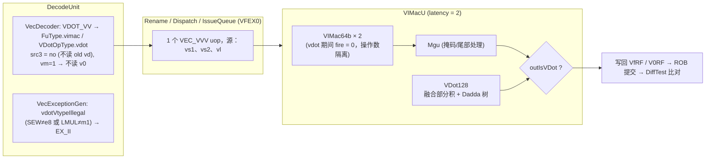
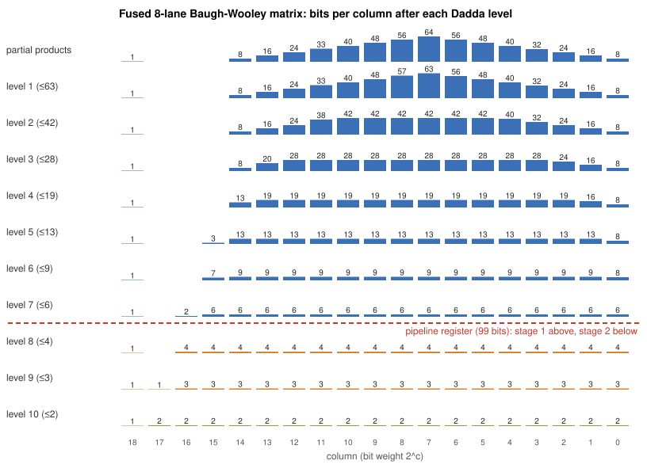

# 阶段二：自定义向量点积指令（`vdot.vv`）设计文档与基础功能测试报告

> **赛题名称**：面向边缘 AI 大语言模型推理的 RISC-V 自定义 `vdot` 指令设计——基于“香山”昆明湖 V2 处理器架构
> **赛事赛道**：2026 CIE 全国 RISC-V 高水平创新及应用大赛（CIE-香山社区·RISC-V 应用创新赛道）
> **覆盖评分项**：阶段二（20%）：`2.1` 自定义指令设计文档、`2.2` 在香山处理器中实现自定义指令、`2.3` 基础功能测试（`2.3.1` 正数、`2.3.2` 负数、`2.3.3` 边界）
> **文档版本**：v3（2026-11-04）。相对上一版：数据通路升级为“全融合 Baugh-Wooley 部分积 + 单棵 Dadda 树”，修正了上一版中与实际代码不符的改动清单、测试表与综合数据，所有测试结果均改为可复现的实测输出（见 `logs/`）。

---

## 1. `vdot.vv` 自定义指令架构规范（ISA Specification）

### 1.1 设计背景与计算语义

在边缘端大语言模型（LLM）W8A8 量化推理中，核心计算是 INT8 向量内积。标准 RVV 1.0 完成一次 8 元素 INT8 点积需要组合 `vwmul.vv`（扩位乘）与 `vwredsum.vs`（扩位归约），并在两者之间切换 `vtype`（`e8 → e16`）。`vdot.vv` 用一条指令完成这一操作，语义严格遵循赛题规范（SEW = 8，VLEN = 128）：

$$\text{sum} = \sum_{i=0}^{7} \mathrm{sext}\!\left(vs1[8i+7 : 8i]\right) \times \mathrm{sext}\!\left(vs2[8i+7 : 8i]\right), \qquad vd[31:0] = \text{sum},\quad vd[127:32] = 0$$

- **输入**：`vs1`、`vs2` 的低 64 位，按字节解释为 8 个 `int8_t`（$[-128, 127]$）；`vs1/vs2[127:64]` 不参与计算。
- **输出**：32 位二进制补码写入 `vd[31:0]`，`vd[127:32]` 清零，可直接被 `vmv.x.s`（SEW=32）或后续向量指令消费。
- **数值范围**：单路乘积 $\in [-16256, 16384]$；8 路和 $\in [-130048, 131072]$，19 位有符号数即可无损表示（见 2.3 节证明）。
- **与 `vl` 无关**：结果只由 `vs1/vs2` 的低 8 个字节决定，`vl` 取任何值（包括 0）结果都相同（RTL 与 NEMU 一致，见第 3 节测试）。

### 1.2 指令编码格式（Instruction Encoding）

`vdot.vv` 复用 `OP-V` 主操作码下的 `OPMVV`（`funct3 = 010`）编码空间，选用 RVV 1.0 未占用的 `funct6 = 001101`，并固定 `vm = 1`：

```text
 31        26 25 24   20 19   15 14   12 11    7 6      0
+------------+--+-------+-------+-------+-------+--------+
|   001101   | 1|  vs2  |  vs1  |  010  |  vd   | 1010111|
+------------+--+-------+-------+-------+-------+--------+
    funct6    vm   5b      5b    funct3    5b     opcode
```

| 字段 | 位域 | 编码 | 说明 |
| :--- | :--- | :--- | :--- |
| `funct6` | `[31:26]` | `001101` | 自定义 `vdot.vv` 功能码（RVV 1.0 OPMVV 未分配） |
| `vm` | `[25]` | `1` | 固定无掩码；`vm = 0` 的编码不匹配 `vdot.vv`，按非法指令处理 |
| `vs2` / `vs1` / `vd` | `[24:20]` / `[19:15]` / `[11:7]` | 任意 | 向量寄存器号（`v0`~`v31`，均合法） |
| `funct3` / `opcode` | `[14:12]` / `[6:0]` | `010` / `1010111` | `OPMVV` / `OP-V` |

- Chisel 译码模式：`BitPat("b0011011??????????010?????1010111")`
- 机器码示例：`vdot.vv v10, v8, v9`（本项目汇编约定为 `vd, vs1, vs2`）= **`0x36942557`**。由于点积可交换，操作数顺序不影响结果。
- 汇编宏：`vdot-contest/software/vdot_macros.h` 中的 `VDOT_VV vd, vs1, vs2` 生成上述编码。

### 1.3 合法性约束与精确异常

以下条件全部满足时指令合法，否则在**译码级**产生非法指令异常（`mcause = 2`），且 `vd` 保持不变：

1. `mstatus.VS != Off`；
2. `vtype.vill == 0`；
3. `SEW == e8`（`vsew == 0`）；
4. `LMUL == m1`（`vlmul == 0`，`m2/m4/m8/mf2/mf4/mf8` 均非法）；
5. `vm == 1`；
6. `vstart == 0`。

上述 13 种非法配置（以及扩展指令 vdota 的 4 种）全部由 `vdot_illegal_test.S` 覆盖（见 3.4 节）。

---

## 2. 香山昆明湖 V2 微架构实现（对应评分项 2.1 & 2.2）

### 2.1 改动清单（与 `xs-vdot-rtl.patch` 逐文件对应）

基线为 XiangShan `f86f50b`（kunminghu-v2 系列主线）。补丁修改 5 个已有文件，新增 3 个文件（含扩展指令 `vdota.vv`，见 2.4 节）：

| 文件 | 改动 | 作用 |
| :--- | :--- | :--- |
| `src/main/scala/xiangshan/backend/decode/Instructions.scala` | 新增 `object CIECustomInstructions { def VDOT_VV = …; def VDOTA_VV = … }` | 定义两条指令的匹配模式 |
| `src/main/scala/xiangshan/backend/decode/VecDecoder.scala` | `opmvv` 表新增 `VDOT_VV -> OPMVV(F, FuType.vimac, VDotOpType.vdot, F, T, F, UopSplitType.VEC_VVV)` 与 `VDOTA_VV -> OPMVV(T, …, VDotOpType.vdota, …)` | 路由到 `vimac` 功能单元；vdot 的 `vdRen = F` 使 `src3 = SrcType.X = 0b0000`（不读 old vd），vdota 的 `vdRen = T` 读 old vd 作累加初值；`VEC_VVV` 在 LMUL=1 时只产生 1 个 uop |
| `src/main/scala/xiangshan/backend/decode/DecodeUnit.scala` | `vmaInsts` 加入 `VDOTA_VV`，并导入 `CIECustomInstructions` | 使 vdota 的 `isDependOldVd = 1`，否则 `NewDispatch`/发射队列的 `ignoreOldVd` 优化在 `vta = 1` 时会去掉它对 old vd 的依赖 |
| `src/main/scala/xiangshan/backend/decode/VecExceptionGen.scala` | 新增 `vdotVtypeIllegal = vdotInst && (vsew != e8 \|\| vlmul != m1)`（`vdotInst` 覆盖两条指令）并入 `io.illegalInst` | 译码级精确异常；`vill`、`vstart != 0`、`VS = Off` 由原有逻辑覆盖，`vm = 0` 因不匹配编码而非法 |
| `src/main/scala/xiangshan/backend/fu/wrapper/VIMacU.scala` | 实例化 `VDot128(accumulate = true)`；`acc := Mux(isVDotA, oldVd(31,0), 0)`；出口 `Mux(outIsVDot, vdot.io.result, mgu.io.out.vd)`；点积期间对两个 `VIMac64b` 做操作数隔离（`fire := io.in.valid && !inIsVDot`） | 复用 `vimac` 的发射端口、2 拍固定延迟、写回与异常通路 |
| `src/main/scala/xiangshan/backend/fu/vector/VDot.scala`（新增） | `VDotOpType`、`VDotTree`、`VDot128` | 点积数据通路（2.3、2.4 节） |
| `src/test/scala/xiangshan/backend/fu/vector/VDotSpec.scala`（新增） | 11 组 ChiselTest 用例 | 单元验证（3.2 节） |
| `src/test/scala/xiangshan/backend/fu/vector/VDotVerilog.scala`（新增） | 导出独立 `VDot128.sv` | 供 Yosys 做 PPA 分析（4.2 节） |

**操作码无冲突**：YunSuan 的 `VimacType` 全部编码只使用 `fuOpType[6:0]`（`[8:7] = 00`），`VDotOpType.vdot = 9'h100`、`vdota = 9'h101` 都置位第 8 位，与任何已有 vimac 操作都不相交。

### 2.2 整体集成架构



关键设计点：

1. **复用而不侵入**：`vdot.vv` 走 `vimac` 已有的发射队列、读口、2 拍固定延迟唤醒、写回端口与异常向量；YunSuan 的 `VIMac64b` 一行未改。
2. **单 uop、无多余源操作数**：`OPMVV(vdRen = F)` 使 `src3` 的类型为 `SrcType.X`（编码 `0b0000`，即“不读寄存器”），因此不存在 old vd 依赖；`vm = 1` 时 `srcType(3) = DC`，不读 `v0`。唯一保留的额外源是所有向量运算共享的 `vl/vtype`（`srcType(4)`），它不影响结果；为避免改动所有向量指令共用的译码逻辑，本版未去除（见 4.4 节）。
3. **旁路 `Mgu`**：`vdot` 固定 `vm = 1`、`vd[127:32] = 0`，不需要掩码与尾部合并，结果在 `VIMacU` 出口直接选出；`vxsat` 对 vdot 恒为 0。
4. **操作数隔离（本版新增）**：原实现中 vdot uop 进入时两个 `VIMac64b` 仍以 `fuOpType` 低位（= `vmul`）计算无用结果。`VIMac64b` 的第一级寄存器使能为 `fire`、第二级为 `GatedValidRegNext(fire)`，因此对 vdot 关闭 `fire` 只会冻结其寄存器，已在流水线中的其他 vimac 操作仍正常流出，功能不受影响，同时消除 128 位乘法阵列的无效翻转。

### 2.3 `VDot128` 数据通路：融合 Baugh-Wooley 部分积 + 单棵 Dadda 树

#### 2.3.1 设计动机

上一版（v2）采用“8 个独立 8×8 乘法器 + 字级 3:2 CSA 树”。每个独立乘法器内部都要把自己的部分积归约到 16 位乘积，**各自带一个 16 位进位传播加法器（CPA）**，随后 CSA 树又要先把这 8 个“已经完全求和”的结果重新压缩。v3 把这两层归约合并为一层：8 路的全部部分积比特放进**同一个比特矩阵**，用**一棵** Dadda 树直接压到 2 行，全电路只在最后保留**一个** 19 位 CPA。

#### 2.3.2 有符号部分积：修正 Baugh-Wooley

对 8 位补码 $a, b$：

$$a\cdot b = \sum_{i<7}\sum_{j<7} a_i b_j 2^{i+j} + a_7 b_7 2^{14} + \sum_{j<7}\overline{a_7 b_j}\,2^{7+j} + \sum_{i<7}\overline{a_i b_7}\,2^{7+i} + \left(2^{8} - 2^{15}\right)$$

推导：负权项 $-x\cdot 2^k = \overline{x}\cdot 2^k - 2^k$，两组 7 个负权项共引入常数 $-2(2^{14}-2^{7}) = 2^8 - 2^{15}$。每路乘积 64 个比特：49+1 个 `AND`、14 个 `NAND`，没有任何符号扩展比特。

**8 路共用一个常数**：$8 \times (2^8 - 2^{15}) = 2^{11} - 2^{18} \equiv 2^{18} + 2^{11} \pmod{2^{19}}$，即整个矩阵只额外多出 **2 个常数 1 比特**（第 11 列和第 18 列）。

矩阵各列高度（第 0~18 列）：`8, 16, 24, 32, 40, 48, 56, 64, 56, 48, 40, 33, 24, 16, 8, 0, 0, 0, 1`，共 **514** 比特。

#### 2.3.3 Dadda 归约与流水线切分

Dadda 高度序列 $d_{j+1} = \lfloor 1.5\, d_j \rfloor$：`64 → 63 → 42 → 28 → 19 → 13 → 9 → 6 → 4 → 3 → 2`，共 10 级全加器/半加器层。每级只在“高度超出目标”的列上放置最少的 FA（每个减 2 比特）/HA（减 1 比特）。各级统计（由生成器实测）：

| 级 | 目标高度 | FA | HA | 本级后剩余比特 |
| :---: | :---: | ---: | ---: | ---: |
| 1 | 63 | 0 | 1 | 514 |
| 2 | 42 | 55 | 3 | 459 |
| 3 | 28 | 102 | 3 | 357 |
| 4 | 19 | 91 | 3 | 266 |
| 5 | 13 | 72 | 2 | 194 |
| 6 | 9 | 52 | 1 | 142 |
| **7** | **6** | **43** | **1** | **99 ← 第一级流水线寄存器** |
| 8 | 4 | 30 | 1 | 69 |
| 9 | 3 | 16 | 1 | 53 |
| 10 | 2 | 16 | 1 | 37（两行） |



（图由 `vdot-contest/rtl-explore/plot_dadda.py` 从同一个经过等价性验证的生成器导出；蓝色为第一拍，橙色为第二拍，红色虚线为流水线寄存器。）

- **Stage 1**：部分积生成（1 级 AND/NAND）+ Dadda 第 1~7 级（415 FA + 14 HA），锁存 **99 位**；
- **Stage 2**：Dadda 第 8~10 级（62 FA + 3 HA）+ **唯一一个 19 位 CPA**，结果锁存后符号扩展到 32 位，`vd[127:32]` 拼 0。

切分点不是拍脑袋选的：第 4.2 节对 0~10 每个切分位置都做了综合，第 7 级之后两级逻辑深度相等（18 = 18）。

#### 2.3.4 无溢出证明

$|\text{sum}| \le 8 \times 2^{14} = 2^{17}$，而 19 位有符号数范围为 $[-2^{18}, 2^{18}-1]$，所以模 $2^{19}$ 的树内运算（列 18 的进位直接丢弃）与真实有符号和完全相等；再符号扩展到 32 位即为架构结果。生成器一般式：`sumBits = 2·elemBits + log2(lanes)`，`lanes = 16`（VLEN = 256）时自动变为 20 位。

#### 2.3.5 Chisel 实现要点（`VDot.scala`）

```scala
class VDot128(vlen: Int = 128, lanes: Int = 8, elemBits: Int = 8,
              cutLevel: Int = VDot128.DefaultCutLevel /* = 7 */) extends Module {
  // 1) 所有 lane 的修正 Baugh-Wooley 部分积放入同一矩阵，外加共享常数 2^18 + 2^11
  // 2) targets.take(cutLevel).foldLeft(pp)(reduceLevel)   -> RegEnable(99 bits, io.en)
  // 3) targets.drop(cutLevel).foldLeft(s2)(reduceLevel)   -> row(0) + row(1)  (唯一的 CPA)
  // 4) RegEnable(sum, stage1Valid);  io.result := Cat(0.U(96.W), stage2.pad(32))
}
```

- `VDotTree.reduceLevel` 是纯 Scala 的阐述期（elaboration-time）算法，逐列放置 FA/HA，生成的是纯组合逻辑；
- `vlen / lanes / elemBits / cutLevel` 全部参数化：同一份代码可生成 VLEN = 256、16 lanes 的版本，也可移动流水线切分点，`VDotSpec` 对 `cutLevel = 0..10` 全部做了验证；
- 时钟门控风格与原设计一致：第一级 `RegEnable(…, io.en)`，第二级 `RegEnable(…, RegNext(io.en))`，非 vdot 周期寄存器不翻转。

### 2.4 扩展指令 `vdota.vv`：累加点积

阶段三的 GEMV 实测发现，赛题定义的 `vdot.vv` 每次只产生一个不带累加的 int32，长向量点积里每一段都要另做 `vadd` 并在 e8/e32 之间切换 `vtype`。为此本项目在不改变 `vdot.vv` 任何行为的前提下，新增一条累加形式：

$$vd[31:0] = vd_{old}[31:0] + \sum_{i=0}^{7} \mathrm{sext}(vs1[8i+7:8i]) \cdot \mathrm{sext}(vs2[8i+7:8i]) \pmod{2^{32}}, \qquad vd[127:32] = 0$$

- **编码**：`funct6 = 001110`、`vm = 1`、`OPMVV`；`vdota.vv v10, v8, v9 = 0x3A942557`。在 XiangShan 全部 901 条译码模式与 NEMU 的译码表中核对过，`001110` 在 OPMVV（`funct3 = 010`）下未被占用（RVV 1.0 中它只在 OPIVV/OPIVX/OPIVI/OPMVX 下有定义）。
- **合法条件**与 vdot 完全相同；按 int32 回绕，与 C 语言中 `uint32_t` 累加一致。
- **集成**：译码 `vdRen = T`（读 old vd）；`vmaInsts` 中登记，保证 old vd 依赖不会被 `ignoreOldVd` 优化掉；`VIMacU` 把 `oldVd[31:0]` 接到 `VDot128.io.acc`（vdot 时接 0）。

**数据通路**：在融合矩阵中多加一行 32 比特（old vd[31:0]），树宽从 19 列扩到 32 列，修正常数改为模 $2^{32}$（`8·(2^8 − 2^15) mod 2^32 = 0xFFFC0800`，共 15 个常数比特），矩阵共 512 + 32 + 15 = **559** 比特，仍然只在最后做一次（32 位）进位传播加法。vdot 与 vdota 共用同一棵树，vdot 时累加行为 0，结果与原来逐位相同。

| Chisel 生成的 `VDot128` | 单元数（gates） | 晶体管（cmos3） | 第一级寄存器位 | 关键级深度 gates / cmos3 |
| :--- | ---: | ---: | ---: | ---: |
| 仅 vdot（19 位树，切分于第 7 级） | 3143 | 21358 | 98 | 20 / 18 |
| vdot + vdota（32 位树，切分于第 7 级） | 3342 | 22214 | 115 | 24 / 20 |
| **vdot + vdota（32 位树，切分于第 8 级，本版采用）** | **3308** | **22188** | **84** | **22 / 20** |
| vdot + vdota（32 位树，切分于第 9 级） | 3299 | 25158 | 68 | 23 / 23 |

即支持累加只多花 **约 4% 晶体管**，关键级多 2 层门（来自 32 位末级加法器与多出的一行）；切分点随之移到第 8 级（第一级只需锁存 84 位）。真实单元库下的结果相近：最长一级 +10~13%、面积 +4~6%，且第 8 级在 ASAP7 中正是最佳切分点（4.6 节）。表中寄存器位数为综合后实际保留的位数（设计上 99 位的那一列有 1 位恒为常数，被 firtool 折叠）。

**验证**：黄金模型新增 5 个 vdota 测试（共 15 个）；`VDotSpec` 新增 3 组（acc = 0 时与 vdot 逐位相同、1000 组随机累加初值含回绕、32 位树的全部 11 个切分点）；裸机程序 `vdota_test.S`（39 组黄金记录、64 步累加链、`vd == vs1 / vs2 / v0` 重叠、与 vdot 交替执行）与 `vdot_illegal_test.S` 新增的 4 种 vdota 非法配置（共 17 种）在 NEMU 与香山 emu（DiffTest）上运行，全部 HIT GOOD TRAP；vdota 依赖链延迟与 vdot 相同（6.73 拍），GEMV 实测比 vdot 快 1.39×（阶段三 2.3、4.3 节）。

---

## 3. 基础功能测试（对应评分项 2.3.1 / 2.3.2 / 2.3.3）

### 3.1 四层验证体系

| 层次 | 载体 | 作用 |
| :--- | :--- | :--- |
| ① 黄金模型 | `vdot-contest/reference/vdot_model.py` + `tests/test_vdot_model.py`（10 个 unittest，含 10 000 组随机） | 可执行的指令规范，同时为裸机测试生成期望值 |
| ② 数据通路等价性 | `vdot-contest/rtl-explore/`：Verilator 同时仿真 v1/v2/v3 全部 9 个变体，逐拍流水输入 **1 131 108** 组向量 | 证明融合树对所有切分点都与参考模型逐位一致 |
| ③ 模块级 ChiselTest | `VDotSpec.scala`：11 组用例（见 3.2） | 验证 Chisel 源码本身（含流水背靠背、全部切分点、256 位实例、累加树） |
| ④ 全芯片 ISA 级 | 香山 `emu`（MinimalConfig，并在默认配置 DefaultConfig 上复测）+ DiffTest（NEMU 作 REF）运行裸机程序 | 在真实香山流水线中执行指令，每条提交与 NEMU 比对 |

### 3.2 ChiselTest：`VDotSpec`

| 用例 | 内容 |
| :--- | :--- |
| positive | `[1..8]·[8..1] = 120`，输出 VCD 波形 |
| negative | `[-1..-8]·[1..8] = -204` |
| boundaries | `8×(-128·-128) = 131072`（最大）、`8×(-128·127) = -130048`（最小）、`8×127² = 129032`、零向量、混合极值 |
| upper 64 bits ignored | `vs1/vs2[127:64]` 填全 1 / 随机噪声，结果不变 |
| lane sweep | lane 0 与 lane 7（符号位最敏感）各扫描全部 256 个字节值 × 6 个对端值，背靠背流水输入 |
| random stream | 2000 组随机向量，每拍一个新操作 |
| every cut position | `cutLevel = 0..10` 共 11 个实例，各 66 组 |
| VLEN = 256 | `VDot128(vlen = 256, lanes = 16)`，20 位精确和，202 组 |
| 累加树：acc = 0 | `VDot128(accumulate = true)`（XiangShan 中实际使用的配置）在 acc = 0 时与 vdot 逐位相同：4 个定向 + 500 组随机 |
| 累加树：累加与回绕 | 定向回绕用例（`0x7fffffff + 120` 等）+ 1000 组随机 32 位累加初值 |
| 累加树：全部切分点 | 32 位树 `cutLevel = 0..10` 共 11 个实例，各 50 组（含随机累加初值） |

实测输出（`mill -i xiangshan.test.testOnly xiangshan.backend.fu.vector.VDotSpec`，完整日志 `logs/chisel.log`）：

```text
VDotSpec:
VDot128
- should compute positive signed INT8 products
- should preserve a negative sum in the low signed 32-bit result
- should cover zero and signed INT8 boundaries
- should ignore the upper 64 bits of both sources
- should sweep every byte value on the lowest and the sign-critical highest lane
- should match a software reference for back-to-back random vectors
- should be correct for every pipeline cut position of the Dadda tree
- should scale to VLEN = 256 with 16 lanes (20-bit exact sum)
VDot128(accumulate = true)
- should give exactly the vdot.vv results when acc = 0
- should add the 32-bit accumulator with int32 wrap-around
- should be correct for every pipeline cut position of the 32-bit tree
Tests: succeeded 11, failed 0, canceled 0, ignored 0, pending 0
All tests passed.
```

### 3.3 全芯片测试：正数 / 负数 / 边界（2.3.1 ~ 2.3.3）

（说明：下面的输出来自最终提交的 RTL，即装有本版融合 Dadda `VDot128` 的 emu；上一版字级 CSA 的 emu 输出逐字节相同，见阶段三 §2.6。）

`vdot-contest/software/bench/vdot_demo.c` 在香山 `emu` 上执行真实的 `vdot.vv v10, v8, v9`，每次执行前把 `v10` 预置为全 `0xff`，执行后用 `vse8.v` 取回完整 128 位 `vd` 并通过 UART 打印；DiffTest 同时在每条指令提交时比对香山与 NEMU 的全部架构状态（含向量寄存器）。

实测输出（香山 `emu` + DiffTest，节选自 `logs/emu.log`；`vd` 由 RTL 中的 `VIMacU/VDot128` 计算，每条指令提交时 NEMU 同步比对）：

```text
[vdot-demo] vdot.vv v10, v8, v9  (0x36942557)
case 2.3.1 positive
  vs1[7:0] = [1, 2, 3, 4, 5, 6, 7, 8]
  vs2[7:0] = [8, 7, 6, 5, 4, 3, 2, 1]
  vd       = 0x00000000_00000000_00000000_00000078
  vd[31:0] = 120  expected 120  PASS
case 2.3.2 negative
  vs1[7:0] = [-1, -2, -3, -4, -5, -6, -7, -8]
  vs2[7:0] = [1, 2, 3, 4, 5, 6, 7, 8]
  vd       = 0x00000000_00000000_00000000_ffffff34
  vd[31:0] = -204  expected -204  PASS
case 2.3.2 mixed sign
  vd       = 0x00000000_00000000_00000000_ffffff88
  vd[31:0] = -120  expected -120  PASS
case 2.3.3 max (-128*-128)
  vd       = 0x00000000_00000000_00000000_00020000
  vd[31:0] = 131072  expected 131072  PASS
case 2.3.3 min (-128*127)
  vd       = 0x00000000_00000000_00000000_fffe0400
  vd[31:0] = -130048  expected -130048  PASS
case 2.3.3 zero
  vd       = 0x00000000_00000000_00000000_00000000
  vd[31:0] = 0  expected 0  PASS
case 2.3.3 high 64b ignored
  vs1/vs2[127:64] = [9..16] / [-9..-16]
  vd       = 0x00000000_00000000_00000000_00000078
  vd[31:0] = 120  expected 120  PASS
[vdot-demo] all cases PASS
Core 0: HIT GOOD TRAP at pc = 0x80000042
Core-0 instrCnt = 14852, cycleCnt = 71532, IPC = 0.207627
```

| 用例（评分项） | vs1[7:0] | vs2[7:0] | 期望 | 香山 RTL 输出 `vd[127:0]` | 结果 |
| :--- | :--- | :--- | ---: | :--- | :---: |
| 正数（2.3.1） | `[1..8]` | `[8..1]` | 120 | `0x00000000_00000000_00000000_00000078` | PASS |
| 负数（2.3.2） | `[-1..-8]` | `[1..8]` | -204 | `0x00000000_00000000_00000000_ffffff34` | PASS |
| 混合符号（2.3.2） | `[-1,-2,-3,-4,5,6,7,8]` | `[8,7,6,5,-4,-3,-2,-1]` | -120 | `0x00000000_00000000_00000000_ffffff88` | PASS |
| 最大值（2.3.3） | `8×-128` | `8×-128` | 131072 | `0x00000000_00000000_00000000_00020000` | PASS |
| 最小值（2.3.3） | `8×-128` | `8×127` | -130048 | `0x00000000_00000000_00000000_fffe0400` | PASS |
| 零（2.3.3） | `8×0` | 任意 | 0 | `0x00000000_00000000_00000000_00000000` | PASS |
| 高 64 位忽略（2.3.3） | `[1..8]`（高位 `[9..16]`） | `[8..1]`（高位 `[-9..-16]`） | 120 | `0x00000000_00000000_00000000_00000078` | PASS |

此外 `vdot_full_test.S` 在同一环境中自动比对 61 组黄金模型向量（13 组定向 + 48 组随机，`vs1/vs2` 高 64 位均含噪声、`vd` 预置 `0xff`），并覆盖：`vl = 1 / 8 / 0` 结果不变；背靠背 RAW/WAW 依赖链（`v10 → v11 → v10`）；寄存器重叠 `vd == vs1`、`vd == vs2`、`vs1 == vs2`、`vd == v0`（香山独立的 v0 寄存器堆）、`v31`；结果被 `vmv.x.s`、`vadd.vv@e32`、`vslidedown` 消费；`vxsat` 不受影响。

### 3.4 精确异常测试

`vdot_illegal_test.S` 覆盖 vdot 的 13 种非法配置：`vm = 0`；`SEW = e16 / e32 / e64`；`LMUL = m2 / m4 / m8 / mf2 / mf4 / mf8`；`vstart = 1`；`vill = 1`（`vsetvl` 写入保留的 `vlmul = 100`）；`mstatus.VS = Off`；以及 vdota 的 4 种（`vm = 0`、`SEW = e16`、`LMUL = m2`、`vstart = 1`），共 17 种。每种情况都检查 `mcause == 2`，并检查执行前预置的 `vd` 在异常后**保持不变**（精确异常），最后再执行一次合法 `vdot.vv` 确认结果为 120。

### 3.5 波形

- 模块级：`VDotSpec` 的 positive 用例输出 VCD（`artifacts/waveforms/vdot128_unit_positive.vcd`，由 Chisel 生成的 v3 RTL 仿真得到，共 2231 个信号，包括全部部分积 `partialProducts_*` 与 99 位 `stage1_*`）。从 VCD 中解析出的实际时序：

  | 时间 | `clock` | `io_en` | `io_vs1[63:0]` / `io_vs2[63:0]` | `stage1Valid` | `stage2` = `io_result[31:0]` | 说明 |
  | ---: | :---: | :---: | :--- | :---: | :---: | :--- |
  | 6 | 0 | 1 | `0x0807060504030201` / `0x0102030405060708` | 0 | 0 | 施加 `[1..8]·[8..1]` |
  | 11 | ↑ | 1 | 同上 | **1** | 0 | 第 1 个上升沿：99 位部分和锁存进第一级 |
  | 16 | 0 | 0 | 同上 | 1 | 0 | |
  | 21 | ↑ | 0 | 同上 | 0 | **`0x78` = 120** | 第 2 个上升沿：结果输出，延迟正好 2 拍 |
- 全芯片：`emu --dump-wave` 导出包含 vdot 指令在 `VIMacU` 中执行全过程的 FST 波形（`artifacts/waveforms/vdot_nemu_test.fst`，见阶段三文档第 2.5 节的信号时序表）。

---

## 4. 微架构设计空间探索（DSE）

### 4.1 评估方法（修正了上一版的两处方法错误）

工具：Yosys 0.33 + ABC，通用门库。脚本：`vdot-contest/rtl-explore/run_explore.py`，结果：`rtl-explore/results.md`。

1. **逻辑深度必须按流水级分别测量**。上一版对整个两级设计运行 `ltp`（未加 `-noff`），得到的是两级串起来的总深度（50 vs 53），并不能说明任何一级的时序。本版把每个设计拆成 `_s1`（输入 → 切分寄存器）和 `_s2`（寄存器 → 和）两个纯组合模块分别综合，取 `ltp -noff`。
2. **测深度时不能用 ABC 默认脚本**。默认脚本带面积回收，会把进位先行加法器“重新串成”行波进位：一个独立的 19 位 `a + b`，Yosys 生成的 Brent-Kung 结构深度为 14，经默认 ABC 后变成深度 36。因此深度一律用面向延迟的脚本 `strash; dch; map -D 1; topo` 测量；面积仍用默认脚本（含面积回收）测量。
3. 两套门库：`gates`（2 输入门 + XOR，单位延迟）；`cmos3`（仅 NAND/NOR/AOI3/OAI3，XOR 需 2~3 级，更接近真实 CMOS 延迟），晶体管数由 `stat -tech cmos` 给出（不含触发器）。

### 4.2 结果

| 方案 | Stage-1 寄存器位 | 单元数（gates） | 晶体管数（cmos3） | S1 深度 gates | S2 深度 gates | S1 深度 cmos3 | S2 深度 cmos3 | **关键级 cmos3** |
| :--- | ---: | ---: | ---: | ---: | ---: | ---: | ---: | ---: |
| v1：8 乘法器 + 加法树（最初版本） | 36 | 4267 | 33518 | 35 | 14 | 30 | 11 | **30** |
| v2：8 乘法器 + 字级 3:2 CSA（上一版） | 76 | 4137 | 29810 | 29 | 19 | 26 | 18 | **26** |
| v3：融合 Dadda，切分于第 3 级 | 357 | 3394 | 22406 | 7 | 30 | 8 | 28 | 28 |
| v3：切分于第 5 级 | 194 | 3230 | 21418 | 13 | 26 | 13 | 23 | 23 |
| v3：切分于第 6 级 | 142 | 3181 | 20948 | 15 | 23 | 15 | 20 | 20 |
| **v3：切分于第 7 级（本版采用）** | **99** | **3139** | **21334** | **18** | **20** | **18** | **18** | **18** |
| v3：切分于第 8 级 | 69 | 3108 | 23356 | 21 | 18 | 20 | 15 | 20 |
| v3：切分于第 9 级 | 53 | 3094 | 23508 | 23 | 16 | 23 | 13 | 23 |

所有变体在同一个 Verilator 测试台中逐拍流水输入 1 131 108 组向量（lane 0 / lane 7 各 65 536 组穷举 + 36 组极值组合 + 100 万组随机，含高 64 位噪声），**0 失配**。

上表是由 Python 生成器直接写出的网表。实际进入香山的是 Chisel/firtool 生成的 RTL，因此对两版 `VDot.scala` 生成的 `VDot128.sv` 用同一流程再测一次（对整个模块取 `ltp -noff`，即两级中较深的一级）：

| Chisel 生成的 `VDot128` | 单元数（gates） | 晶体管（cmos3） | 触发器 | 关键级深度 gates | 关键级深度 cmos3 |
| :--- | ---: | ---: | ---: | ---: | ---: |
| v2（上一版，字级 CSA） | 5147 | 39404 | 88 | 32 | 34 |
| **v3（本版，融合 Dadda，cut = 7）** | **3143** | **21358** | 118 | **20** | **18** |
| 变化 | **-38.9%** | **-45.8%** | +30 | **-37.5%** | **-47.1%** |

v3 的 Chisel 输出与 Python 网表的结果几乎完全一致（3139 / 21334 / 20 / 18），说明 Chisel 生成器构造的正是经过等价性验证的同一结构。v2 的 Chisel 输出比 Python 版更大，是因为 firtool 对 `SInt(8) * SInt(8)` 先符号扩展到 16 位再相乘，综合出的乘法阵列更大——这也从侧面说明：手工构造部分积矩阵，不依赖综合器对 `*` 的处理方式，结果更可控。

结论：

- **v3（切分于第 7 级）相对上一版 v2：关键流水级深度 26 → 18（-31%），晶体管 29810 → 21334（-28%），单元数 -24%**（Python 网表口径；按 Chisel 实际生成的 RTL 口径为 -47% / -46% / -39%，见上表）；代价是第一级寄存器从 76 位增至 99 位（+23 个触发器，约 +550 个晶体管，远小于组合逻辑节省的约 8500 个）。
- 相对最初的 v1：关键级 30 → 18（-40%），晶体管 -36%。
- 上一版 v2 的 CSA 改造本身是有效的（关键级 30 → 26，晶体管 -11%），但上一版文档中“第 2 拍深度 32 → 19（-40.6%）”的数字来自上述错误方法，已废弃。
- 切分点越靠前，第一级寄存器越多（c3 需要 357 位）；越靠后，第二级越深。第 7 级是两级深度相等、寄存器数量适中的平衡点。
- 以上是通用门口径；在 NanGate 45 nm 与 ASAP7 7 nm 真实单元库下的复核（带物理单位的每级延迟与面积、与香山现有乘法器的比较）见 4.6 节。

**与商用综合工具的关系（诚实说明）**：Synopsys DC 等工具在“datapath extraction”下能把 $\sum a_i b_i$ 表达式自动融合成一棵 CSA 树；但自动融合后流水线寄存器只能放在乘加整体的前后，要把寄存器放进树的中间需要依赖寄存器重定时（retiming）。v3 在 RTL 中显式构造树并显式放置切分点，与工具无关地得到平衡的两级流水，这也是 YunSuan `VIMac64b`（Wallace 树在 `wallaceOut_mid` 处切分）采用的做法。

### 4.3 与 `VIMac64b` 复用的权衡（交接文档方向三）

同一流程综合香山生成 RTL 中的 `VIMac64b.sv`：**单个 `VIMac64b` 约 39 442 个单元、18.2 万晶体管 + 838 个触发器**，`VIMacU` 内有两个。融合版 `VDot128` 的组合逻辑约 2.1 万晶体管，**约为两个 `VIMac64b` 的 6%**。

复用 `VIMac64b` 的乘法器需要在其第 2 拍的 16 位逐 lane 加法器（`sum_wo`）之后再串接跨 lane 归约，要么把 `vimac` 第 2 拍拉长（拖累所有 vimac 指令的时序），要么为 vdot 增加第 3 拍（固定延迟改变会影响发射队列的唤醒调度），并且要修改 YunSuan 子模块。用 6% 的面积换取零时序耦合与零回归风险，本设计选择独立模块。

### 4.4 后端源操作数检查（交接文档方向四）

- `old vd`：`OPMVV(vdRen = F)` → `src3 = SrcType.X = 0b0000`（`SrcType.isVp` 为假），重命名/派遣/发射均不会为其建立依赖，已无可优化空间；
- `v0`：`srcType(3) = Mux(inst.VM === 0.U, SrcType.vp, SrcType.DC)`，vdot 固定 `vm = 1`，不读 `v0`；
- `vl/vtype`（`srcType(4)`）：所有向量算术指令共享，vdot 的结果不依赖 `vl`。理论上可以为 vdot 单独置为 `SrcType.no`，使其不必等待前面 `vsetvli` 的 `vl` 写回。但这需要改动所有向量指令共享的 `DecodeUnit` 逻辑；而在典型循环中 `vsetvli` 被外提或只在若干条 vdot 之前出现一次，这一依赖只影响紧跟在 `vsetvli` 之后的那一条 vdot（估计为 1~2 拍，本版未做 RTL 对照实验）。因此本版未改动，列为后续工作。

### 4.5 扩展性（对应“扩展应用潜力”）

- **更宽 VLEN**：`VDot128(vlen = 256, lanes = 16)` 直接生成 16 路、20 位精确和的版本，已通过 `VDotSpec`；
- **累加形式 `vdota.vv`（vd[31:0] += Σ）**：已实现（2.4 节）。融合树只多一行 32 比特，晶体管 +4%，仍然只有一个 CPA；NEMU、裸机测试、ChiselTest 与全芯片 DiffTest 全部覆盖。
- **分组形式（下一步）**：“2 组 × 8 字节 → 2 个 int32”或“4 组 × 4 字节 → 4 个 int32”，每条指令用满 128 位数据通路。生成器已经能按 lane 数生成任意宽度的树，分组只需把矩阵按组拆成 2~4 棵独立的 Dadda 树。阶段三 §4.3~4.5 的实测表明 GEMV 已接近向量加载上限，分组形式的收益主要在数据在寄存器中复用、受计算吞吐限制的内核。

### 4.6 真实工艺库下的综合时序（NanGate 45 nm / ASAP7 7 nm）

前面的比较用的是 Yosys/ABC 的通用门，每个门算作一样快，只能比较“经过多少层门”。为了得到带物理单位的数字，把同一批 Chisel 生成的 RTL 映射到两个开源标准单元库上，做综合级静态时序分析。

**方法**（`vdot-contest/rtl-explore/pdk_ppa.py`，完整输出见 `logs/pdk.log`）：

- 单元库：NanGate 45 nm Open Cell Library（typical 角）与 ASAP7 7 nm 预测工艺（RVT、TT 角），取自 OpenROAD-flow-scripts（commit `d056a2b`）；不可用单元列表与 OpenROAD 流程相同。
- 按流水级分别计时：把所有寄存器变成端口（`expose -evert-dff`），由网表自动给寄存器分级（D 端的级数 = 其上游最深寄存器的级数 + 1），每一级的逻辑锥单独用 ABC 映射到单元库，再用 ABC 的 `stime` 报告最长路径（NLDM 查表、按扇出计负载、输入由 X2 缓冲器驱动、不含连线）。面积取自含触发器的整模块映射（`dfflibmap` + `stat -liberty`）。
- 两种 ABC 脚本：`struct` 按 Yosys 构造的结构（Dadda 树、Brent-Kung 加法器）直接映射；`restructure` 是 Yosys 的默认脚本，映射前先做 AIG 重写。后者会把加法器的进位重新串长（例如带累加的树切分于第 10 级时，第二级只剩一个 32 位加法器，`restructure` 下却比第 9 级还慢），结果偏大且不单调，因此下面以 `struct` 为主，`restructure` 作对照。
- 参照：香山现有乘法器 `VIMac64b`（`VIMacU` 中与 `VDot128` 并列的两个模块，已在昆明湖中使用）用同一流程处理。它有三级：S1、S2 和 S2 寄存器之后到输出的一段。

**结果**（`struct`，单位 ps 与 µm²）：

| 设计 | NanGate45 S1 / S2 | 面积 | ASAP7 S1 / S2 | 面积 |
| :--- | ---: | ---: | ---: | ---: |
| v2：4 棵字级 CSA 树 + 4 个 CPA（上一版） | 1158 / 549 | 6662 | 718 / 375 | 578 |
| v3：仅 vdot，切分于第 7 级 | 720 / 747 | 4120 | 394 / 405 | 348 |
| **v3：带累加行，切分于第 8 级（最终，`VIMacU` 中实例化）** | **841 / 672** | **4287** | **446 / 421** | **369** |
| `VIMac64b`（S1 / S2 / 输出段） | 938 / 1964 / 1003 | 35243 | 554 / 1569 / 661 | 3060 |

切分点扫描（`struct`，两级中较长的一级，ps）：

| 切分于第几级 | 6 | 7 | 8 | 9 | 10 |
| :--- | ---: | ---: | ---: | ---: | ---: |
| 仅 vdot，NanGate45 | 826 | **747** | 793 | 905 | 1014 |
| 仅 vdot，ASAP7 | 459 | **405** | 451 | 510 | 560 |
| 带累加，NanGate45 | 956 | **800** | 841 | 924 | 1043 |
| 带累加，ASAP7 | 546 | 501 | **446** | 503 | 561 |

结论：

1. **融合 Dadda 的改进在真实单元库下仍然成立**：相对上一版，最长一级 1158 → 747 ps（NanGate45，-35%）/ 718 → 405 ps（ASAP7，-44%），面积 -38% / -40%。与 4.2 节通用门口径（关键级 -47%、晶体管 -46%）方向一致，幅度略小。
2. **切分点的选择得到确认**：只做 vdot 的树在两个库中最佳都是第 7 级，与 4.2 节按门层数选出的相同；带累加的树在 ASAP7 中最佳就是本设计采用的第 8 级，在 NanGate45 中第 7 级比第 8 级短 5%（800 对 841 ps）。
3. **累加的代价**：最长一级 +13%（NanGate45，747 → 841 ps）/ +10%（ASAP7，405 → 446 ps），面积 +4% / +6%，与 2.4 节通用门估计（+2 层门、晶体管 +4%）一致。
4. **不会成为 `VIMacU` 中最长的一级**：同一流程下，最终 `VDot128` 最长的一级（841 / 446 ps）比 `VIMac64b` 最短的一级（938 / 554 ps）还短 10% / 20%。`VIMac64b` 的 S2 尤其长：它把 128 位结果拆成 8 段 16 位加法，段间进位按 SEW 逐段传递，关键路径是一长串 AOI21/OAI21。
5. **对照（`restructure` 脚本）**：所有数值普遍更大，`VDot128` 最终版为 792 / 1076 ps（NanGate45）、475 / 826 ps（ASAP7）；它仍远短于 `VIMac64b` 的 S2（4757 / 3671 ps），但长于后者的 S1（867 / 573 ps）。结论 1、3 不变；结论 4 只在 `struct` 口径下成立。
6. **局限**：这是综合级时序，没有布局布线、连线延迟、时钟树与时钟偏差，单元库也不是昆明湖实际使用的工艺，香山实际的商用流程（以及可能使用的寄存器重定时）与这里不同。例如 `VIMac64b` 在这里每一级都超过 3 GHz 对应的 333 ps，而它在昆明湖中是能工作的。因此这些绝对值不能用来判断能否跑到 3 GHz，只用于同一流程下的相对比较。附带的触发器开销（表格中间点）：NanGate45 `DFF_X1` clk→q 111 ps、setup 40 ps；ASAP7 `DFFHQNx1` clk→q 83 ps、setup 11 ps。
